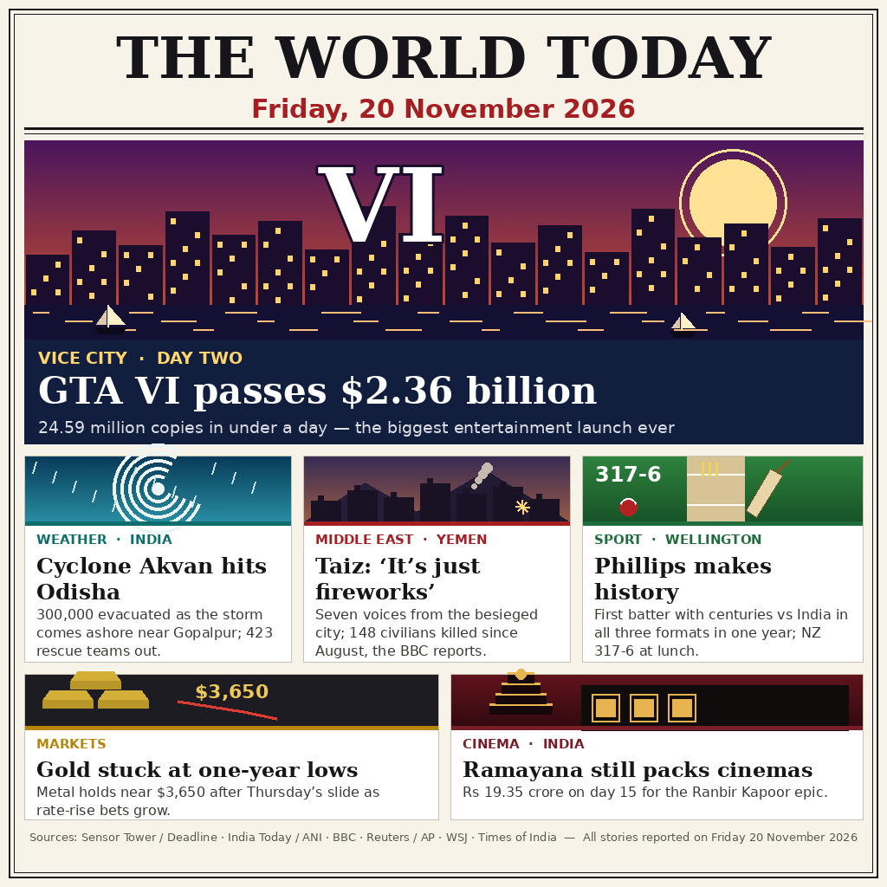

# The World Today — Friday, 20 November 2026

A one-page newspaper poster summing up the world news of **Friday, 20 November 2026**,
built for the [news-image-20261120](https://make.fun) competition on make.fun.

## Stories on the poster

| Story | What it says |
|---|---|
| **GTA VI passes $2.36 billion** (hero) | 24.59 million copies in under a day — the biggest entertainment launch ever, Sensor Tower reports via Deadline. |
| **Cyclone Akvan hits Odisha** | 300,000 evacuated as the storm comes ashore near Gopalpur; 423 rescue teams out. (India Today / ANI) |
| **Taiz: 'It's just fireworks'** | Seven voices from the besieged Yemeni city; 148 civilians killed since August, the BBC reports. |
| **Phillips makes history** | First batter with centuries vs India in all three formats in one calendar year; NZ 317-6 at lunch in Wellington. (Reuters / AP) |
| **Gold stuck at one-year lows** | Metal holds near $3,650 after Thursday's slide as rate-rise bets grow. (WSJ) |
| **Ramayana still packs cinemas** | Rs 19.35 crore on day 15 for the Ranbir Kapoor epic. (Times of India) |

Every story was checked against its primary source's publication date — only
news that happened or was first reported on 20 November 2026 is on the page.
Research notes: [RESEARCH.md](RESEARCH.md).

## How it was made

- The poster was drawn entirely with Python (Pillow): gradients, skyline and
  palm silhouettes, cyclone spiral, mountains, cricket pitch, gold bars and
  film strip are all vector-style shapes drawn in code — no photographs, no
  logos, no pasted artwork.
- `render_poster.py` renders `entry.png` (1024×1024, 110,115 bytes).
- `main.py` (Python standard library only) copies the pre-rendered `entry.png`
  to the grader output directory and verifies the copy byte-for-byte against
  its known SHA-256 hash, because the grading sandbox has no image libraries
  or fonts.

## License

MIT — see [LICENSE](LICENSE).
